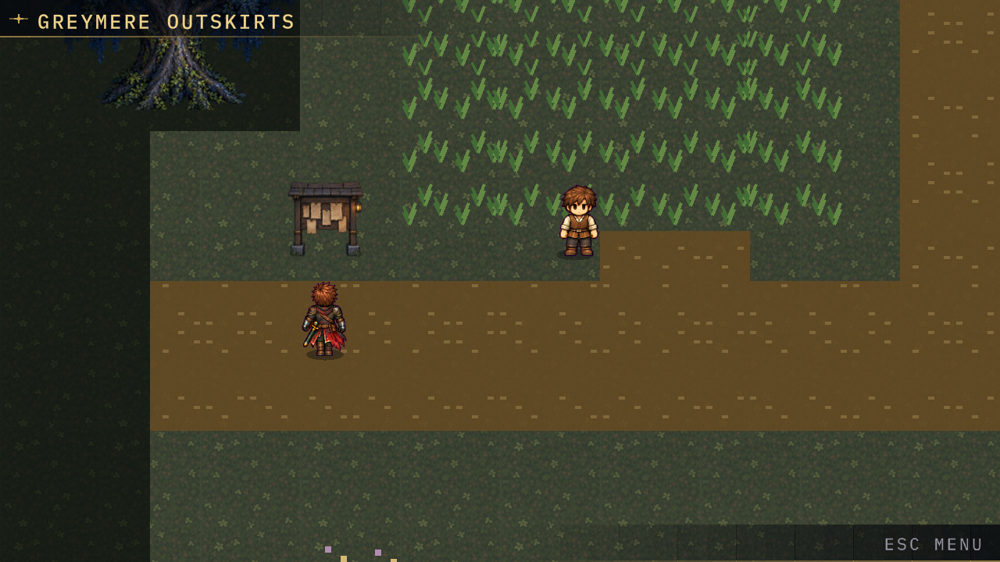
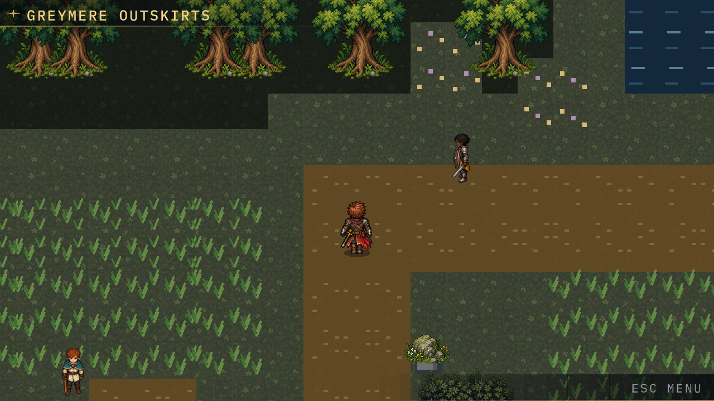
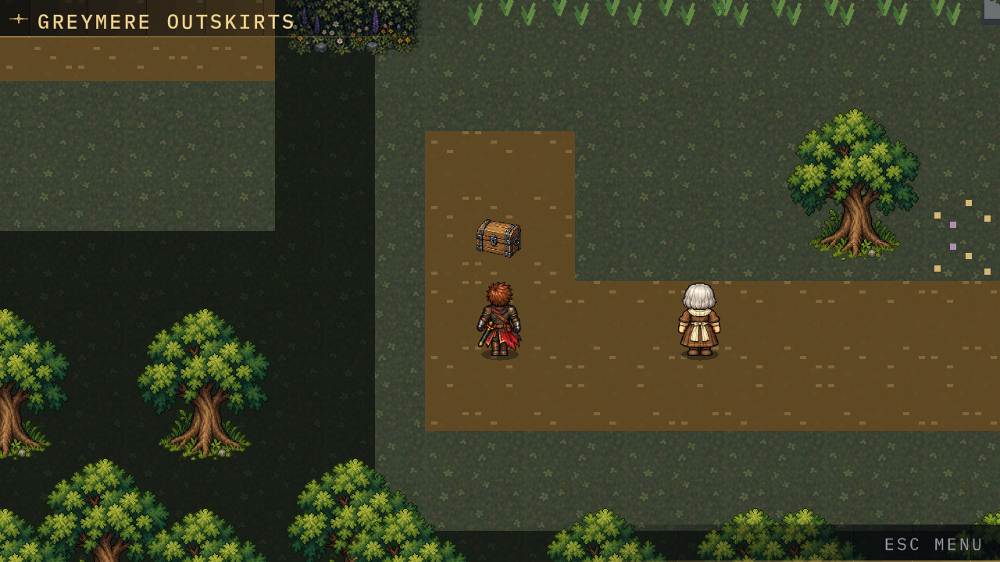
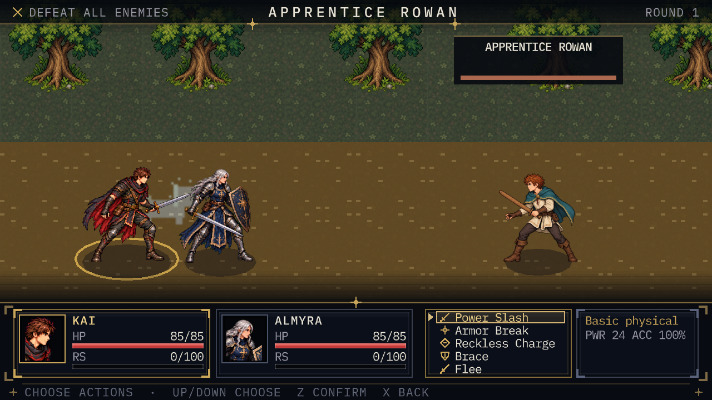

# Greymere Outskirts — Route 01

## Playable slice

From Greymere's southern approach, face the southern road exit and press Z
(Travel). Route 01 is a 60×35 tile map of connected forest clearings and a
winding dirt road. The western exit returns to town; the northern sign marks a
closed future-region gate. Both arrival spawns are separated from exit tiles.
Doors retain the existing adjacent-interaction controls, including interiors.

Three roadside duelists have fixed facings and four-tile, obstacle-aware sight.
Entering their line triggers a short exclamation, dialogue and the existing
party setup / battle scenes. Talking also starts a challenge. A confirmed
victory sets an individual defeated flag; later conversations use alternate
text. Cancellation returns to the saved tile without a win. Defeat restores the
party and retreats to Greymere's southern approach. An interrupted setup or
reload cannot leave a transient battle lock behind.

Tall-grass steps have a 12% encounter probability and eight-step cooldown.
These are **raider ambushes using the existing class-based combat**, not creature
collection. Safe terrain never rolls an encounter. Menus, dialogue, trading,
alerts, scene transitions and other battles suppress rolls. An initial six-step
grace and battle-return grace prevent immediate chains. RNG state is serialized
as a decimal string (avoiding JSON 64-bit precision loss), alongside cooldowns.

A side clearing contains two Potions in a one-time chest. The existing inventory,
item catalogue, save manager and field bag are reused. There is also a location
sign, a traveller with directions, flowers, a pond and the closed northern gate.

## Ownership and extension

- `tools/route_01_world.py` owns the authored route, placements, encounter zones,
  spawns, recovery destination, messages and environment-based battle backdrop.
  `python tools/build_greymere_world.py` compiles it into the existing world JSON.
- `WorldLocation` handles shared interactions and movement-step encounter hooks.
  `WorldEncounters` owns callable LOS and seeded, step-based encounter rules.
- `GameState` stores inventory/flags and per-location encounter state. A transient
  battle-return dictionary is deliberately omitted from save payloads. Version-2
  saves without the new fields load with defaults; the save version is unchanged.
- YAML remains the source of truth for all four new encounters; the exporter
  generates both JSON copies. Difficulty is a gentle 2v1 against a Crest-less
  opponent, with no parallel stat or damage implementation.
- `BattleController` and `PartySetup` route world encounter outcomes through that
  return context. Existing Hollow Court behaviour remains intact.
- Runtime atlases are materialized by the same PixelLab walk build step as PR #24.
  Standing poses, directional animation, depth sorting and camera behaviour reuse
  the existing engine. The route HUD uses a short label to fit the current plate.

## Validation

The Python topology/data tests verify every map spawn and interaction is
reachable, both transition directions, valid encounter/class/art/item references,
and reproducible map compilation. `route_smoke.tscn` runs in the real Godot client:
walking, both travel directions, all three trainer activations, LOS and blocking,
modal suppression, grass dialogue/setup, step cooldown, chest duplication,
actual battle resolution with a test-only enemy-HP fixture, victory persistence,
return/re-entry, alternate dialogue, old-save defaults and defeat recovery.
The existing world smoke continues to visit all six interiors and the Court.

QA includes native 720p/1080p captures of the route, grass approach, side clearing
and outdoor battle, plus release Web export and existing browser checks. Results
and any environment limitations are recorded in the pull request; this document
is not itself a claim that every check has completed.

## Deliberate limits

- Trainers stay at their fixed tile. The current NPC class has no walking/pathing
  system, so no separate movement implementation was introduced for approach.
- Trainers now have distinct generated battle art, portrait crops and four static
  overworld facings; see `ROUTE_01_ASSETS.md`. They do not approach or walk.
- Legacy chroma-key edges receive spatial despill. Legitimate purple interiors
  remain intact; this is not a claim that every source asset has been repainted.
- Field battles now offer guaranteed Flee during command selection. It retains
  damage, grants return grace and awards no victory/rewards. Story battles do not
  expose withdrawal. This adventure-only action does not change Python duel balance.
- The northern gate is intentionally closed, with explanatory text, rather than
  linking to a missing scene. No unrelated world-map or engine rewrite is included.

## Inspected native renders

The following are actual Godot 4.3 llvmpipe renders at 1280×720, captured and
visually inspected during this implementation, not mock-ups:

The initial presentation CI run exposed an asset-build dependency ordering bug:
PixelLab's Pillow-based materializer was invoked before dependencies were
installed. Presentation validation now installs development dependencies first;
Web deployment explicitly installs Pillow before materialization. Render QA's
existing dependency setup already installs Pillow.

## Final local check results

- 266 Python tests passed; focused route/navigation tests passed after formatting.
- Ruff passed for the new Python route definition and route tests; Python source
  compilation and JavaScript syntax checking passed.
- Godot editor import/static checks passed; the walk audit reported no flags.
- The final real-client route harness reported `ROUTE_SMOKE: 0 failures`.
- Existing `WORLD_SMOKE: 0 failures` verified the six interior transitions.
- Release Web export succeeded. Playwright ran against that exported build with
  no page errors, checked four viewport sizes, and captured route travel, the
  route menu and return to Greymere. Those browser renders were inspected and
  showed the correct route/town HUD and corresponding scene in each direction.
- Four native 720p captures were inspected. CI additionally repeats selected
  route/battle captures at 1080p and runs the gameplay/Web checks.

The headless dummy renderer can emit a custom-sampler diagnostic and existing
missing move-VFX warnings. These did not cause gameplay failures; the actual
OpenGL/native and browser renders were inspected separately.

## Route art and withdrawal follow-up

Added dedicated trainer and scenery atlases with genuine alpha, shared
presentation records and declarative collected-chest appearances. The runtime
owns flee eligibility and its one-shot outcome; the command menu emits intent.
Field damage uses the same persistence path as victory. New route records do not
replace the canonical village residents or the existing player walk strips.

Validation after this follow-up: 267 Python tests passed, Ruff/static Godot checks
passed, route and interior harnesses reported zero failures, and Web release
export succeeded. Four native 720p renders were inspected, including the five-row
command menu with Flee. The route smoke test selects Flee through real menu input
and checks return location, health, no trainer victory and rematch grace.

## Visual cohesion pass

Audit: the high-resolution PixelLab scenery and character art was consistent;
the inconsistency came from the procedural terrain drawn around it — flat
rectangular road fills with a dashed pattern, the same tall-grass tuft repeated
per tile, a flat black overlay that made the forest look like a cut-out
rectangle, a grass texture that repeated every 2×2 tiles, procedural rock/fence
blocks drawn underneath their own authored props, and forest oaks on a strict
4-tile grid.

`WorldTerrain` now dresses outdoor tiles deterministically (coordinate
hashes and low-frequency value noise, no runtime RNG): mirrored grass blocks,
subtle 8px tonal drift and sparse ground detail; mottled dirt roads with
irregular grass verges and rounded corners; varied tall-grass tufts that thin
out at patch edges; small flowers; and forest shade that deepens with distance
from open ground and spills softly onto the adjacent tiles. Interiors are
unchanged, and so is collision: everything here reads `rows` only for
presentation. Route data staggers the forest-fill oaks and gives the two
remaining blocking stones a one-tile `route_stone` prop, so no footprint changes.
